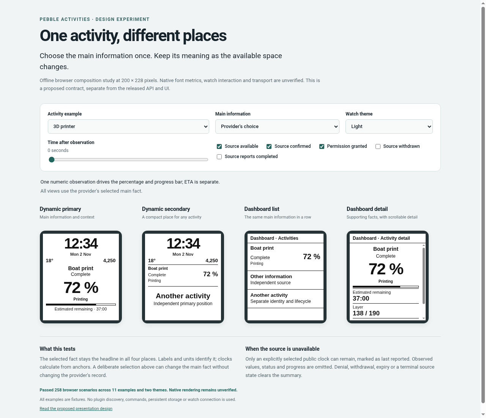

# Activity presentation study

**Status: exploratory browser study.** The
[native technical design](../NATIVE-ACTIVITY-DESIGN.md) supersedes this as the next
implementation plan. Its bounded version 1 summary does not adopt this study's
six-fact record or arbitrary main-fact selection.

This offline experiment checks the revised
[presentation design](../CONSUMER-PRESENTATION-DESIGN.md): a provider explicitly
selects its main fact, and each consumer decides how to display it. It compares
both Dynamic positions with Dashboard row and detail compositions at 200 by 228
pixels. The browser drawings are composition studies, with approximate fonts and
geometry; they are separate from the native apps and the released API.

Open [index.html](index.html) in a modern browser. The folder is self-contained;
it uses no server, remote assets, dependencies, plugin discovery or real data.



## Explore the contract

Choose one of 11 examples, then change the main information, theme or elapsed
time. Source availability, confirmation, permission, withdrawal and completion
controls exercise the visibility rules. Main selection is an explicit consumer
override and leaves the provider's record unchanged.

Useful comparisons:

- [Workout interval versus elapsed time](index.html?case=workout&headline=rest)
  distinguishes two clocks in one activity.
- [Printer percentage with supporting facts](index.html?case=printer) uses one
  measurement for its displayed percentage and progress bar.
- [Last-reported 24-hour clock](index.html?case=long&confirmed=0) retains time and
  its uncertainty indication while removing supporting observations.
- [Private music without a source](index.html?case=music&available=0) clears from
  every view.
- [Chess](index.html?case=chess) keeps one player's clock paused while the other
  counts down. Detail labels identify paused or due supporting clocks.

The provisional record has identity and trust metadata, a reference to one main
fact, and a flat list of labelled text, value or clock facts. It allows at most
six facts in this study. A progress range references an existing scalar fact.
A value uses either a scalar or a formatted expression, preventing conflicting
copies; a separate unit stays attached. Clock rules follow the existing
countdown/elapsed meanings, independently for each fact. These names and limits
are experiment choices, not new public properties.

## Run the checks

From the repository root:

```sh
node docs/presentation-study/check.js
python3 docs/presentation-study/check-browser.py
```

The first command needs Node.js. The second needs Python 3 and Chromium or Google
Chrome; pass `--browser /path/to/browser` if needed. It opens only the local page,
disables background networking and reports measured DOM overflow. It uses an
isolated temporary browser profile. Optional `--output` and `--screenshot` paths
save results and a preview.

Opening [the browser sweep](index.html?sweep=1) also runs the layout scenarios.
The footer shows the outcome, and `window.studyReport` contains the report.
Modern browser and Node facilities used here are not a claim of Pebble PKJS
runtime compatibility.

## Recorded results

On 2 November 2026, [validation.json](validation.json) records:

- 37 passing semantic check groups across 11 fixtures and four surfaces.
- 258 passing browser scenarios across both themes, including source loss,
  uncertainty, expiry, denial, withdrawal, completion and every main-fact override.
- Zero measured overflow errors for main content, distinguishing labels, units
  and trust indications. The sweep reports 32 optional text elisions separately.

Semantic checks cover independent clocks, backward time changes, explicit
selection, progress consistency, missing estimates, privacy and stale mixed
content. Both phone disconnection and provider failure on a connected phone use
the same conservative retention rules. Countdown zero preserves the source's
active state; it does not manufacture a completion event.

The browser sweep preserves all selected headline text in these fixtures;
optional activity titles, status and supporting summaries can shorten. Dashboard
detail scrolls instead of requiring every fact to fit at once. This evidence
covers these examples, not arbitrary future strings or screens. Native font
metrics, pixel rendering, transport compatibility, real providers, catalogue
paging and command delivery require separate implementation and validation.

## Files

| File | Purpose |
| --- | --- |
| [fixtures.js](fixtures.js) | Synthetic activities with mixed content |
| [model.js](model.js) | Pure projection, time and visibility rules |
| [ui.js](ui.js) and [style.css](style.css) | Generic browser presentations and fitting checks |
| [check.js](check.js) | Semantic contract checks |
| [check-browser.py](check-browser.py) | Repeatable local browser sweep |

No published source properties, ACT1 fields, package versions or native app
renderers are changed by this experiment. The next implementation needs a
separately specified versioned extension and native captures.
